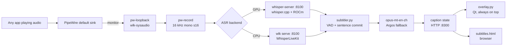

# whisper-live

**English** | [简体中文](README.zh-CN.md)

[](LICENSE)
[](#requirements)
[](#requirements)

Real-time subtitles for whatever your computer is playing. whisper-live takes the system audio
mix, recognizes speech on your own machine, translates it to Chinese, and draws two lines —
Chinese on top, the original below — in a borderless overlay above every window.

If you can hear it, it can be subtitled: a video player, a live stream, a game, a call, a
browser tab. No file path, meeting URL or player plugin is involved.


## What you get

- **System audio, not a microphone.** `run.sh` builds a PipeWire loopback from the default
  sink's monitor, so the capture sees exactly what the speakers see. Other applications do not
  need to cooperate or change their output device.
- **Local recognition.** On an AMD GPU, whisper.cpp runs large-v3-turbo through ROCm/HIP at
  about 0.4 s per 8 s of audio. Without a usable GPU it falls back to WhisperLiveKit and
  faster-whisper on the CPU.
- **Sentence-level captions.** A line appears when the sentence ends, not word by word. Once
  a line is on screen it is not rewritten; the Chinese translation arrives with it.
- **Local translation by default.** opus-mt-en-zh runs on the CPU, around 0.1–0.15 s per
  sentence, and no text leaves the machine. MyMemory cloud polish is optional.
- **An overlay above fullscreen video.** Frameless Qt window, always on top, clicks pass
  through to the player underneath. Mask, font scale, dwell time and position are adjustable.
- **A browser page as well.** <http://127.0.0.1:8300> shows the same captions with history and
  font-size buttons, which is handy on a second screen.
- **Desktop entry, no sudo.** `install.sh` writes only under `~/.local`.


## Requirements

| | |
|---|---|
| OS | Linux with PipeWire. Developed on Ubuntu 26.04 with GNOME on Wayland; Ubuntu 24.04+ should work the same. |
| Audio | PipeWire + WirePlumber (`pw-loopback`, `pw-record`, `wpctl`) |
| Python | 3.12 |
| [uv](https://docs.astral.sh/uv/) | creates both virtual environments |
| GPU (optional) | An AMD GPU with ROCm/HIP and `hipcc`. CPU-only works. |
| Desktop | Qt 6 via PySide6. The overlay runs on X11/XWayland (`QT_QPA_PLATFORM=xcb`). |

The overlay needs a global always-on-top window above other applications, which a plain
Wayland client cannot do. It runs through XWayland, which GNOME and KDE start by default.
A session without XWayland will show the browser page but no overlay.

## Quick start

### 1. Get the code

```bash
git clone https://github.com/Xcli0126/whisper-live.git
cd whisper-live
```

### 2. System packages

```bash
sudo apt update
sudo apt install -y pipewire wireplumber ffmpeg curl git cmake fonts-noto-cjk libxcb-cursor0
```

`fonts-noto-cjk` is what the overlay uses for Chinese text. `libxcb-cursor0` is needed by
the Qt 6 xcb platform plugin.

For the GPU backend, install ROCm and make sure `hipcc` and `rocminfo` are on `PATH`
(see the [ROCm installation guide](https://rocm.docs.amd.com/projects/install-on-linux/en/latest/)).
Everything below also runs without it.

### 3. Python environments

```bash
uv venv --python 3.12 .venv
uv pip install --python .venv/bin/python \
  whisperlivekit faster-whisper transformers sentencepiece \
  opencc-python-reimplemented argostranslate websockets numpy onnxruntime

uv venv --python 3.12 .venv-qt
uv pip install --python .venv-qt/bin/python pyside6-essentials
```

`.venv` holds the recognition and translation stack; `.venv-qt` only holds PySide6 so the
overlay and the configuration window start quickly.

### 4. Models

The scripts download from ModelScope, because Hugging Face was not reachable from the machine
this was built on. They are plain HTTP downloads; point them elsewhere if you prefer.

```bash
# CPU recognizer, medium is a good size/latency trade-off (1.5 GB)
REPO=gpustack/faster-whisper-medium ./get-model.sh

# GPU recognizer: builds whisper.cpp with HIP, fetches large-v3-turbo, converts to ggml f16
./build-gpu.sh

# en -> zh translation model, about 300 MB
bash test/dl_opus.sh
```

Run the first and third commands on any machine. Run `build-gpu.sh` only where ROCm is
installed; it passes `-DGGML_HIP=ON -DAMDGPU_TARGETS=gfx1151` to CMake and takes a few
minutes. Override the architecture when yours differs:

```bash
AMDGPU_TARGETS=gfx1100 ./build-gpu.sh
```

`get-model.sh` defaults to large-v3 (2.9 GB). A smaller model is usually the better choice on
a CPU; `REPO=gpustack/faster-whisper-small ./get-model.sh` gets the 462 MB one.

Optional offline fallback for translation, used when opus-mt output looks broken:

```bash
.venv/bin/argospm install translate-en_zh
```

### 5. Start

```bash
./run.sh
```

The first run creates the virtual source `wlk-sysaudio`, starts the recognizer on
`127.0.0.1:8100`, the caption service on `127.0.0.1:8300`, and the overlay. Play something
with speech; the caption appears at the bottom of the screen within a few seconds.

```bash
./status.sh   # what is running, which backend, which models
./stop.sh     # stop services, keep the virtual source
```

Open <http://127.0.0.1:8300> for the browser view.

### 6. Desktop entry

```bash
./install.sh              # app menu entry "Live Subtitles", launcher in ~/.local/bin
./install.sh --uninstall  # remove both
```

The launcher opens the configuration window (`app.py`), which starts and stops the pipeline
and edits the same settings as `run.sh`'s environment variables.

## Latency modes

`LATENCY` changes how long a finished sentence waits for its translation before it is shown.
It does not change recognition itself.

| Mode | Value | What reaches the screen | Character |
|---|---|---|---|
| Stable | `stable` | The sentence, after the polished translation is ready (waits up to 3.5 s, then uses the local draft) | Most accurate, one sentence behind |
| Balanced | `balanced` (default) | The sentence with the local draft, cloud text replaces it if it arrives before 2.4 s | One sentence behind |
| Fast | `fast` | The unfinished sentence too, rewritten every 0.45 s as recognition changes its mind | Immediate, visibly unstable |

With the default `MT=local` the three modes feel nearly identical: the local translation lands
about 0.1–0.15 s after the sentence is committed, well inside every deadline. The differences
show up when cloud polish is enabled, or in fast mode's partial line.

```bash
LATENCY=fast ./run.sh
MT=auto LATENCY=stable ./run.sh
```

## Subtitle appearance

Everything here is in the configuration window and stored in
`~/.config/whisper-live/overlay.json`. The overlay re-reads that file every 400 ms, so
changes apply without a restart.

| Setting | Range | Notes |
|---|---|---|
| Mask | gray, black, none | Rounded rectangle behind the text; gray is `rgb(58,58,62)` |
| Mask opacity | 20–90% | Default 55% |
| Font scale | 70–180% | Base size is 3% of screen height, clamped to 30–68 px |
| Dwell | 0–60 s | Hide after this much silence; 0 keeps the last line forever. Default 9 s |
| Position | drag the overlay | Button in the config window enters edit mode; arrows move 10 px, Shift+arrow 40 px, Esc saves |

The Chinese line is white with a black outline and a soft shadow; the English line is slightly
smaller in `rgb(228,232,238)`. Font scale multiplies both. When source and target language are
the same, only one line is drawn.

## How it works



1. **Capture.** A loopback source mirrors the default sink's monitor. `subtitler.py` reads it
   with `pw-record --rate 16000 --channels 1 --format s16` in 100 ms chunks.
2. **Recognize.** On the GPU path the same process runs silero VAD, cuts speech into sentences,
   and posts the current sentence to whisper-server's `/inference` every 0.45 s. Text is only
   committed when two consecutive decodes agree on it. On the CPU path WhisperLiveKit does its
   own streaming with a LocalAgreement policy. Either way, `subtitler.py` receives lines with
   stable indices.
3. **Translate.** opus-mt translates each committed line; Argos is the fallback when the output
   looks degenerate. A finished Chinese line unlocks the matching English line, and they are
   published together in order.
4. **Render.** The overlay polls `/snap` every 150 ms and repaints only when the caption
   version changes. The browser page reads the same snapshot.

More detail, including the process and thread layout and the reasons behind sentence-level
committing, is in [docs/ARCHITECTURE.md](docs/ARCHITECTURE.md).

## Configuration

`run.sh` passes its environment through; the defaults are what a fresh clone uses.

| Variable | Default | Effect |
|---|---|---|
| `ASR_ENGINE` | `auto` | `gpu` uses whisper.cpp when it is built and the ggml model exists; `cpu` forces WhisperLiveKit |
| `LAN` | `en` | Source language given to the recognizer; `auto` enables detection |
| `LANGS` | `en,zh` | Translation pair; equal values disable translation. A source starting with `zh` forces `zh,zh` |
| `LATENCY` | `balanced` | `stable`, `balanced` or `fast` |
| `MT` | `local` | `local`, `argos`, `auto` or `mymemory` |
| `MT_DEBOUNCE` | 0.05 local, 0.4 otherwise | Seconds to wait before translating a line |
| `PUBLISH_DEADLINE` | 3.5 / 2.4 / 1.0 | Set by `LATENCY`; longest wait for a final translation |
| `ASR_PORT`, `UI_PORT` | `8100`, `8300` | Loopback HTTP ports |
| `NODE` | `wlk-sysaudio` | Name of the virtual source |
| `MODEL_DIR` | first of medium / large-v3 / small | faster-whisper model directory |
| `GPU_MODEL` | `models/whisper-turbo/ggml-model.bin` | ggml model for whisper-server |
| `OV` | `1` | `0` starts without the overlay |

Overlay-only variables: `SNAP_URL`, `BOTTOM_MARGIN` (default 60 px), `OVERLAY_CONF`,
`SCREEN_LOG`. `run.sh` sets `SNAP_URL` itself.

Examples:

```bash
LAN=zh ./run.sh                      # Chinese source, one line, no translation
ASR_ENGINE=cpu MODEL_DIR=models/faster-whisper-medium ./run.sh
OV=0 ./run.sh                        # browser page only
```

## Measured on the development machine

AMD Radeon 8060S (gfx1151), 32 threads, Ubuntu 26.04. Times are from pressing play on an
11-second English clip until the first line was on screen.

| Model | Backend | Size | First English line | First Chinese line |
|---|---|---|---|---|
| small | CPU | 462 MB | 2.1 s | 6.1 s |
| medium | CPU | 1.5 GB | 4.4 s | 6.8 s |
| large-v3 | CPU | 2.9 GB | 8.0 s | 10.2 s |
| large-v3-turbo | GPU | 1.6 GB | 3.3 s | 5.7 s |

A GPU decode of an 8-second window takes 0.36–0.46 s, which is what keeps partial decodes at
0.45 s intervals. These numbers are a sanity check, not a benchmark; a different CPU or GPU
will land elsewhere.

## Troubleshooting

| Symptom | First thing to try |
|---|---|
| No subtitles at all | `./status.sh`; read `logs/launcher.log` and `logs/asr.log` |
| Chinese line missing, English only | `bash test/dl_opus.sh`, then restart |
| Overlay invisible, page works | `logs/overlay.log`; check XWayland is running |
| "ROCm devices" not found | `./status.sh`; rebuild with the right `AMDGPU_TARGETS` |
| Translation hangs or repeats | Try `MT=argos`, check the model directory |
| Model download fails | Re-run the script; partial files are safe to delete |

Longer explanations, with the exact log lines to grep for, are in
[docs/TROUBLESHOOTING.md](docs/TROUBLESHOOTING.md).

## Project layout

```text
run.sh              start loopback + recognizer + caption service + overlay
stop.sh             stop the four pieces, wait for ports
status.sh           check source, services, backend, models, translation
build-gpu.sh        build whisper.cpp with HIP, fetch and convert turbo
get-model.sh        fetch a faster-whisper model from ModelScope
subtitler.py        audio capture, ASR client, translation, HTTP/WS service
asr_gpu.py          VAD segmentation and whisper-server client for the GPU path
overlay.py          frameless always-on-top caption window
app.py              configuration window
subtitles.html      browser caption page
install.sh          desktop entry, icon and launcher (and --uninstall)
icon.svg            launcher icon
docs/               architecture, troubleshooting, screenshots
test/               model download helper and capture diagnostics
```

## Limitations

- Linux and PipeWire only. macOS and Windows would need a different capture layer.
- The overlay depends on XWayland; a pure Wayland session gets the browser page but no
  always-on-top window.
- Bundled local translation is English to Chinese. Other pairs need an Argos package or the
  cloud engine.
- Model scripts download from ModelScope. If you are outside its reach, replace the base URL
  in `get-model.sh`, `build-gpu.sh` and `test/dl_opus.sh`.
- Cloud polish sends subtitle text to MyMemory. It is off by default.

## Acknowledgements

Built on [whisper.cpp](https://github.com/ggml-org/whisper.cpp),
[WhisperLiveKit](https://github.com/QuentinFuxa/WhisperLiveKit),
[faster-whisper](https://github.com/SYSTRAN/faster-whisper),
[opus-mt-en-zh](https://huggingface.co/Helsinki-NLP/opus-mt-en-zh),
[Argos Translate](https://github.com/argosopentech/argos-translate), PipeWire and Qt.

## License

[MIT](LICENSE) © 2026 Xcli0126
