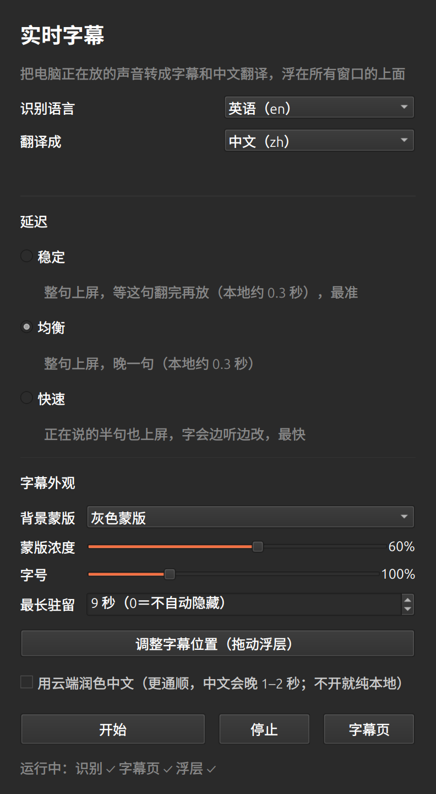
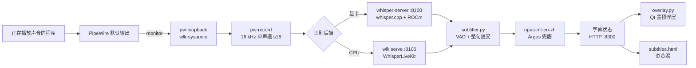

# whisper-live

**简体中文** | [English](README.md)

[](LICENSE)
[](#环境要求)
[](#环境要求)

把电脑正在播放的声音实时转成双语字幕：本地识别，翻成中文，再用一个无边框浮层把「中文一行
+ 原文一行」盖在所有窗口上面。

视频、直播、游戏、会议、浏览器标签页都一样——只要你能听见，它就能上字幕，不需要文件路径、
会议链接，也不需要播放器配合。


## 能做什么

- **抓系统声音，不占麦克风。** `run.sh` 从默认输出设备的 monitor 建一个 PipeWire 回环源，
  听到的就是扬声器听到的。别的程序不用改输出设备，也不用装插件。
- **本地识别。** AMD 显卡上 whisper.cpp 走 ROCm/HIP 跑 large-v3-turbo，8 秒音频约 0.4 秒
  出结果。没有可用显卡时退回 WhisperLiveKit + faster-whisper，纯 CPU 也能跑。
- **整句上屏。** 一句话说完才出现一行，不是一个词一个词跳。已经上屏的原文不会被改写，
  中文和它一起出现。
- **默认离线翻译。** opus-mt-en-zh 跑在 CPU 上，每句约 0.1–0.15 秒，文字不出本机。
  MyMemory 云端润色是可选项，默认关闭。
- **浮层盖在全屏视频上。** Qt 无边框窗口，置顶，鼠标点击穿透到下面的播放器。蒙版、字号、
  停留时间、位置都能调。
- **另有浏览器字幕页。** <http://127.0.0.1:8300> 显示同样的字幕，带历史记录和字号按钮，
  放第二块屏上看比较方便。
- **装进应用菜单，不需要 sudo。** `install.sh` 只写 `~/.local`。



## 环境要求

| | |
|---|---|
| 系统 | Linux + PipeWire。开发机是 Ubuntu 26.04 / GNOME / Wayland，Ubuntu 24.04+ 用法相同。 |
| 音频 | PipeWire + WirePlumber（`pw-loopback`、`pw-record`、`wpctl`） |
| Python | 3.12 |
| [uv](https://docs.astral.sh/uv/) | 建两个虚拟环境 |
| 显卡（可选） | 支持 ROCm/HIP 的 AMD 显卡，需要 `hipcc`。没有就用 CPU。 |
| 桌面 | Qt 6 / PySide6。浮层跑在 X11/XWayland 上（`QT_QPA_PLATFORM=xcb`）。 |

浮层要盖住别的窗口，纯 Wayland 客户端做不到全局置顶。它通过 XWayland 运行，GNOME 和 KDE
默认都会启动 XWayland。没有 XWayland 的会话只能看浏览器字幕页。

## 快速开始

### 1. 取代码

```bash
git clone https://github.com/Xcli0126/whisper-live.git
cd whisper-live
```

### 2. 系统依赖

```bash
sudo apt update
sudo apt install -y pipewire wireplumber ffmpeg curl git cmake fonts-noto-cjk libxcb-cursor0
```

`fonts-noto-cjk` 是浮层显示中文用的，`libxcb-cursor0` 是 Qt 6 xcb 插件需要的。

要用显卡后端，先装 ROCm，确认 `hipcc` 和 `rocminfo` 在 `PATH` 里（见
[ROCm 安装文档](https://rocm.docs.amd.com/projects/install-on-linux/en/latest/)）。
不装也能跑完下面的步骤。

### 3. Python 环境

```bash
uv venv --python 3.12 .venv
uv pip install --python .venv/bin/python \
  whisperlivekit faster-whisper transformers sentencepiece \
  opencc-python-reimplemented argostranslate websockets numpy onnxruntime

uv venv --python 3.12 .venv-qt
uv pip install --python .venv-qt/bin/python pyside6-essentials
```

`.venv` 装识别和翻译，`.venv-qt` 只装 PySide6，浮层和配置窗口启动快一些。

### 4. 模型

脚本从 ModelScope 下载，因为开发机连不上 Hugging Face。都是普通 HTTP 下载，想换源直接改
脚本里的地址。

```bash
# CPU 识别模型，medium 是速度和体积比较平衡的一档（1.5 GB）
REPO=gpustack/faster-whisper-medium ./get-model.sh

# 显卡识别模型：编译 whisper.cpp（HIP），下载 large-v3-turbo 并转成 ggml f16
./build-gpu.sh

# 英译中模型，约 300 MB
bash test/dl_opus.sh
```

第一条和第三条在任何机器上都能跑。`build-gpu.sh` 只在装了 ROCm 的机器上跑，它给 CMake
传 `-DGGML_HIP=ON -DAMDGPU_TARGETS=gfx1151`，编译要几分钟。显卡架构不同就覆盖：

```bash
AMDGPU_TARGETS=gfx1100 ./build-gpu.sh
```

`get-model.sh` 默认拉 large-v3（2.9 GB）。纯 CPU 一般选小一号更合适，
`REPO=gpustack/faster-whisper-small ./get-model.sh` 是 462 MB 那档。

可选的离线翻译兜底，opus-mt 输出明显坏掉时才会用到：

```bash
.venv/bin/argospm install translate-en_zh
```

### 5. 启动

```bash
./run.sh
```

第一次运行会建虚拟音源 `wlk-sysaudio`，然后在 `127.0.0.1:8100` 起识别服务、
`127.0.0.1:8300` 起字幕服务、最后起浮层。放一段有人说话的东西，几秒内屏幕下方就会出现字幕。

```bash
./status.sh   # 看服务、后端、模型状态
./stop.sh     # 停服务，虚拟音源保留
```

浏览器打开 <http://127.0.0.1:8300> 是网页版字幕。

### 6. 应用菜单

```bash
./install.sh              # 应用菜单里的「实时字幕」+ ~/.local/bin/whisper-live
./install.sh --uninstall  # 两个都删掉
```

启动器打开配置窗口（`app.py`），可以启停整条链路，改的也是 `run.sh` 那套环境变量。

## 三种延迟档

`LATENCY` 只决定「整句识别完之后，等译文等多久再上屏」，不影响识别本身。

| 档位 | 取值 | 屏幕上出现什么 | 感觉 |
|---|---|---|---|
| 稳定 | `stable` | 整句，等译文定稿（最多等 3.5 秒，超时用本地草稿） | 最准，慢一句 |
| 均衡 | `balanced`（默认） | 整句，先用本地草稿，云端在 2.4 秒内回来就替换 | 慢一句 |
| 快速 | `fast` | 没说完的半句也上，每 0.45 秒按识别结果改写 | 跟得紧，但会跳动 |

默认 `MT=local` 时三档差别很小：本地译文在整句提交后约 0.1–0.15 秒就出来，怎么都赶得上
截止时间。差别主要体现在开了云端润色之后，以及快速档的半句预览。

```bash
LATENCY=fast ./run.sh
MT=auto LATENCY=stable ./run.sh
```

## 字幕外观

下面这些在配置窗口里调，存在 `~/.config/whisper-live/overlay.json`。浮层每 400 毫秒重读
一次，改完不用重启。

| 项 | 范围 | 说明 |
|---|---|---|
| 蒙版 | 灰、黑、无 | 文字后面的圆角矩形，灰色是 `rgb(58,58,62)` |
| 蒙版不透明度 | 20–90% | 默认 55% |
| 字号 | 70–180% | 基准是屏幕高度的 3%，限制在 30–68 px |
| 停留 | 0–60 秒 | 这么久没有新字幕就隐藏；0 表示一直留着。默认 9 秒 |
| 位置 | 拖动浮层 | 配置窗口里点「调整字幕位置」进入，方向键移 10 px，Shift+方向键 40 px，Esc 保存 |

中文一行是白字黑描边加一点阴影，原文行稍小，颜色 `rgb(228,232,238)`。字号缩放对两行同时
生效。源语言和目标语言相同时只画一行。

## 工作原理



1. **采集。** 回环源复制默认输出的 monitor，`subtitler.py` 用
   `pw-record --rate 16000 --channels 1 --format s16` 按 100 毫秒一块读。
2. **识别。** 显卡路线上，同一个进程跑 silero VAD，把语音切成句子，每 0.45 秒把当前句子
   发给 whisper-server 的 `/inference`。连续两次解码结果一致才提交。CPU 路线上
   WhisperLiveKit 用 LocalAgreement 自己流式出字。两条路给 `subtitler.py` 的都是带稳定
   序号的整句。
3. **翻译。** opus-mt 翻译已提交的句子，输出明显退化时换 Argos。这句中文定稿后，对应的
   原文行才解锁，两行按顺序一起发布。
4. **显示。** 浮层每 150 毫秒拉一次 `/snap`，版本号变了才重绘。浏览器页读的是同一份快照。

进程/线程模型、整句上屏的取舍、显卡后端怎么起，写在
[docs/ARCHITECTURE.md](docs/ARCHITECTURE.md)。

## 配置项

`run.sh` 把环境变量透传下去，不写就是下表默认值。

| 变量 | 默认 | 作用 |
|---|---|---|
| `ASR_ENGINE` | `auto` | 编译好 whisper.cpp 且 ggml 模型存在时用 `gpu`；`cpu` 强制 WhisperLiveKit |
| `LAN` | `en` | 传给识别器的源语言，`auto` 开自动检测 |
| `LANGS` | `en,zh` | 翻译对；两个值相同时不翻译 |
| `LATENCY` | `balanced` | `stable`、`balanced`、`fast` |
| `MT` | `local` | `local`、`argos`、`auto`、`mymemory` |
| `MT_DEBOUNCE` | 本地 0.05，其他 0.4 | 一句提交后等多久再翻译 |
| `PUBLISH_DEADLINE` | 3.5 / 2.4 / 1.0 | 由 `LATENCY` 设定，等定稿译文的上限 |
| `ASR_PORT`、`UI_PORT` | `8100`、`8300` | 本机端口 |
| `NODE` | `wlk-sysaudio` | 虚拟音源名字 |
| `MODEL_DIR` | medium / large-v3 / small 里第一个可用的 | faster-whisper 模型目录 |
| `GPU_MODEL` | `models/whisper-turbo/ggml-model.bin` | whisper-server 用的 ggml 模型 |
| `OV` | `1` | `0` 表示不启动浮层 |

浮层自己的变量：`SNAP_URL`、`BOTTOM_MARGIN`（默认 60 px）、`OVERLAY_CONF`、
`SCREEN_LOG`。`SNAP_URL` 由 `run.sh` 设置。

例子：

```bash
LAN=ja LANGS=ja,zh ./run.sh
LAN=auto LANGS=auto,zh ./run.sh     # 让识别器判断语言
ASR_ENGINE=cpu MODEL_DIR=models/faster-whisper-medium ./run.sh
OV=0 ./run.sh                        # 只开浏览器页
```

## 实测

开发机：AMD Radeon 8060S（gfx1151），32 线程，Ubuntu 26.04。时间从按下播放到第一行字幕
出现，素材是 11 秒英文片段。

| 模型 | 后端 | 体积 | 首行英文 | 首行中文 |
|---|---|---|---|---|
| small | CPU | 462 MB | 2.1 秒 | 6.1 秒 |
| medium | CPU | 1.5 GB | 4.4 秒 | 6.8 秒 |
| large-v3 | CPU | 2.9 GB | 8.0 秒 | 10.2 秒 |
| large-v3-turbo | 显卡 | 1.6 GB | 3.3 秒 | 5.7 秒 |

显卡解码 8 秒窗口要 0.36–0.46 秒，所以半句解码间隔定在 0.45 秒。这些数字只是量级参考，
换 CPU 或显卡结果会不一样。

## 常见问题

| 现象 | 先做什么 |
|---|---|
| 完全没有字幕 | `./status.sh`，看 `logs/launcher.log` 和 `logs/asr.log` |
| 只有英文，没有中文 | `bash test/dl_opus.sh`，然后重启 |
| 网页有字幕，浮层不显示 | 看 `logs/overlay.log`；确认 XWayland 在跑 |
| 提示找不到 ROCm 设备 | `./status.sh`；用正确的 `AMDGPU_TARGETS` 重编 |
| 翻译卡住或反复重复 | 换 `MT=argos`，检查模型目录 |
| 模型下载失败 | 重跑脚本；下了一半的文件可以直接删 |

更长的排查步骤，以及该 grep 哪几行日志，在
[docs/TROUBLESHOOTING.md](docs/TROUBLESHOOTING.md)。

## 目录结构

```text
run.sh              启停整条链路：回环源、识别、字幕服务、浮层
stop.sh             停四个进程，等端口释放
status.sh           检查音源、服务、后端、模型、翻译引擎
build-gpu.sh        编译 whisper.cpp（HIP），下载并转换 turbo
get-model.sh        从 ModelScope 拉 faster-whisper 模型
subtitler.py        读音频、连识别、翻译、提供 HTTP/WS 服务
asr_gpu.py          显卡路线的 VAD 切句和 whisper-server 客户端
overlay.py          无边框置顶字幕浮层
app.py              配置窗口
subtitles.html      浏览器字幕页
install.sh          桌面项、图标、启动器（以及 --uninstall）
icon.svg            启动器图标
docs/               架构、排查、截图
test/               模型下载脚本和采集诊断脚本
```

## 限制

- 只支持 Linux + PipeWire。macOS 和 Windows 要另写采集层。
- 浮层依赖 XWayland。纯 Wayland 会话只有浏览器页，没有置顶窗口。
- 自带的本地翻译只有英译中。其他方向要装 Argos 语言包，或者开云端。
- 模型脚本从 ModelScope 下载。连不上就改 `get-model.sh`、`build-gpu.sh`、
  `test/dl_opus.sh` 里的下载地址。
- 云端润色会把字幕文本发给 MyMemory，默认不开。

## 致谢

用到了 [whisper.cpp](https://github.com/ggml-org/whisper.cpp)、
[WhisperLiveKit](https://github.com/QuentinFuxa/WhisperLiveKit)、
[faster-whisper](https://github.com/SYSTRAN/faster-whisper)、
[opus-mt-en-zh](https://huggingface.co/Helsinki-NLP/opus-mt-en-zh)、
[Argos Translate](https://github.com/argosopentech/argos-translate)、PipeWire 和 Qt。

## 许可

[MIT](LICENSE) © 2026 Xcli0126
