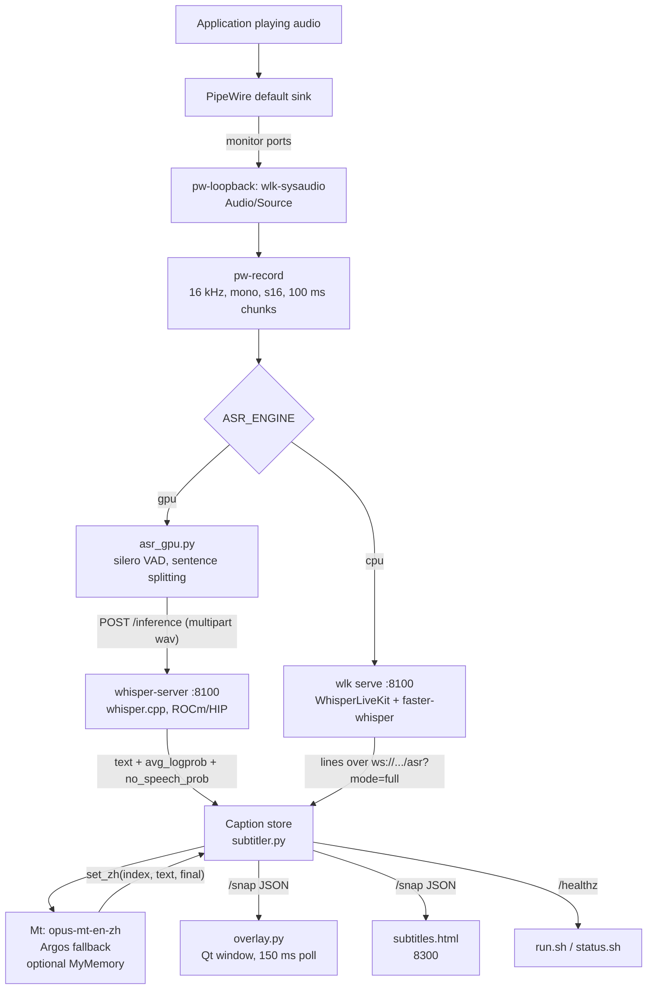

# Architecture

This document describes how the pieces fit together, which process does what, and why the
pipeline commits whole sentences instead of streaming words. File names refer to the repository
root.

## Data flow



The caption store is the only shared state. The recognizer, the translator and the two renderers
never talk to each other directly; they read or write the store through a small HTTP surface.

## Processes and threads

| Process | Started by | Responsibility | Listens on |
|---|---|---|---|
| `pw-loopback` | `run.sh` (`setsid nohup`) | Exposes the default sink's monitor as the source `wlk-sysaudio` | — |
| `whisper-server` | `run.sh` | whisper.cpp inference over HTTP, GPU only | `127.0.0.1:8100` |
| `wlk serve` | `run.sh` | WhisperLiveKit streaming ASR, CPU only | `127.0.0.1:8100` |
| `subtitler.py` | `run.sh` | Capture, ASR client, translation, caption store, web server | `127.0.0.1:8300` |
| `overlay.py` | `run.sh` | Always-on-top caption window | — |
| `app.py` | user / desktop entry | Configuration window; starts and stops `run.sh` | — |

`run.sh` writes `run/asr.pid`, `run/ui.pid` and `run/overlay.pid` and appends to
`logs/asr.log`, `logs/ui.log`, `logs/overlay.log` and `logs/launcher.log`. `stop.sh`
uses the pid files first, then pattern matches the three command lines, then waits for the
ports to close.

Inside `subtitler.py` everything runs on one asyncio loop:

- `audio_reader` reads `pw-record` in 3200-byte chunks (100 ms at 16 kHz mono s16) and updates
  the RMS level.
- `gpu_feed` (GPU) or `feed` (CPU) turns audio into caption lines.
- `translator` walks lines that have been committed but not translated, calls the engine in the
  default executor, and publishes the result.
- `broadcaster` pushes state versions to websocket clients.
- `buffer_translator` exists only with `--live-preview 1` (fast mode) and translates the
  unstable tail.

Blocking work (HTTP to whisper-server, transformer generation, Argos) runs in the executor so
the audio reader is not stalled by a decode.

`overlay.py` is a single-threaded Qt application driven by three timers: 150 ms snapshot poll,
400 ms configuration reload, 500 ms fade check. `app.py` runs its own Qt loop, polls the two
ports every 1.5 s and spawns `run.sh` or `stop.sh` as child processes.

## Audio capture

`run.sh` asks PipeWire for the current default sink and mirrors its monitor:

```bash
pw-loopback \
  --capture-props="node.target=$SINK stream.capture.sink=true" \
  --playback-props="media.class=Audio/Source node.name=wlk-sysaudio \
                    node.description=System-Audio-Monitor"
```

The result is an ordinary source, so `pw-record` and any other recorder can read it. Because
the loopback follows the default sink only at creation time, switching output devices later
requires `./stop.sh && ./run.sh`; `status.sh` reports a missing default sink.

`pw-record --target wlk-sysaudio --rate 16000 --channels 1 --format s16 -` deliberately asks
for the format whisper.cpp wants: 16 kHz, mono, signed 16-bit little endian. No resampling
happens in Python.

## GPU recognition path

`build-gpu.sh` compiles whisper.cpp with `-DGGML_HIP=ON` and an `AMDGPU_TARGETS` value
taken from `rocminfo` (falling back to `gfx1151`), then converts whisper-large-v3-turbo from
the Hugging Face layout to a ggml f16 file at `models/whisper-turbo/ggml-model.bin`.

`run.sh` starts it as:

```bash
whisper-server -m models/whisper-turbo/ggml-model.bin \
  --host 127.0.0.1 --port 8100 -l en -nt --convert -bs 1 -bo 1
```

`-nt` disables timestamps in the text output, `--convert` lets the server accept the WAV that
`asr_gpu.py` posts, `-bs 1 -bo 1` keeps beam search at one beam. A single decode of an
8-second window takes 0.36–0.46 s on the development GPU.

`asr_gpu.py` is the client and the segmentation logic:

- **VAD.** silero through onnxruntime, `VADIterator(threshold=0.5,
  min_silence_duration_ms=250, speech_pad_ms=120)` over 512-sample frames (32 ms), with a
  six-frame pre-roll so the first phoneme is not clipped.
- **Scheduling.** While a sentence is open, a partial decode is queued every 0.45 s. If the
  previous request is still running (`jobs.qsize() >= 1`), the new partial is dropped instead
  of queued; queueing them made the decoder fall further behind with every sentence.
- **Finalization.** Silence longer than 250 ms, a 10 s cap (`MAX_SEG`), or end of stream
  triggers a final decode of the whole segment.
- **Hallucination filter.** A decode is discarded when `no_speech_prob > 0.45` or
  `avg_logprob < -0.85`. Those are the two signals whisper.cpp returns with
  `response_format=verbose_json`.
- **Commit rule.** A sentence fragment is committed only if it ends at punctuation, is at least
  10 characters, and appeared in the previous decode as well. Comparison uses
  `[a-z0-9]` only, so a changed comma or capitalization does not invalidate an otherwise
  stable prefix.
- **Tail append.** When the final decode extends a committed prefix, the remainder is appended
  as a new line. When it disagrees, the already published lines are kept and the segment is
  reset.

## CPU recognition path

Without a usable GPU, `run.sh` starts WhisperLiveKit with
`--backend faster-whisper --backend-policy localagreement --pcm-input`, reading PCM from the
websocket rather than a file. `subtitler.py` connects to `ws://127.0.0.1:8100/asr?mode=full`
and reconnects every 3 s if the connection drops. Messages carry lines with stable indices;
`apply_full()` keeps placeholder entries so an index never shifts under a translation that is
still in flight.

The CPU path is the slow one: 4.4 s to the first English line with medium, 8.0 s with
large-v3 on the development machine.

## Sentence commitment

A caption line has three states: recognized, committed, translated.

1. `commit_line()` appends the recognized text and records `_committed_at`.
2. The translator produces a Chinese draft for that index.
3. `set_zh(index, text, final=True)` marks the translation final.
4. `_flush()` publishes index `_cap_idx + 1`, then the next, as long as each is final.

Publishing is index-gated on purpose. Translation finishes out of order under load, and a
caption display that reorders lines is worse than one that is a line late. The single index
gate makes the screen advance monotonically; the cost is that one slow line holds back the
ones behind it.

The deadline limits that cost. If a committed line has no final translation after
`PUBLISH_DEADLINE` (3.5 s / 2.4 s / 1.0 s depending on `LATENCY`), the current draft is
published as final, unless the local engine is still computing it. That is what keeps
`MT=auto` usable when MyMemory is slow or unreachable.

Fast mode adds a second, separate path: `buffer_translator` translates the unstable tail and
`set_buffer_zh()` replaces it only while the new draft still matches the current buffer or the
caption on screen. Drafts that no longer match are dropped rather than shown.

## Translation

`Mt` prefers `models/opus-mt-en-zh` loaded through transformers (MarianMTModel and
MarianTokenizer). Generation is capped at 64 tokens with two beams and
`no_repeat_ngram_size=4`. The output goes through punctuation cleanup and OpenCC
traditional-to-simplified conversion before it is stored.

Marian models loop on short or noisy input. The output is rejected and Argos is tried when the
text contains Latin letters, is shorter than two characters, repeats an n-gram, or is inflated
relative to the input. Argos runs through CTranslate2 with the package installed under
`~/.local/share/argos-translate/packages`; outputs containing U+FFFD are dropped.

`MT=auto` and `MT=mymemory` additionally call MyMemory with two attempts and a 25 s cooldown
after a failure, so a broken network cannot turn into one request per caption.

## HTTP and websocket surface

`subtitler.py` serves three routes on `127.0.0.1:8300`:

| Route | Response |
|---|---|
| `GET /` | `subtitles.html` |
| `GET /healthz` | `ok`, used by `run.sh` and `status.sh` |
| `GET /snap` | JSON snapshot: `cap_src`, `cap_zh`, `same_lang`, `buffer`, `buffer_zh`, `level`, `asr`, `status`, `v`, last 40 lines |

The websocket endpoint is used by the browser page for live updates. `v` increments on every
state change; the overlay compares it and skips repainting when nothing moved.

## Overlay

The window is created with `FramelessWindowHint | WindowStaysOnTopHint | Tool` and
`WindowTransparentForInput`, and `QT_QPA_PLATFORM` defaults to `xcb`. This is the part that
needs XWayland: Wayland has no protocol for "a normal client above everything, click-through".

Rendering is manual. `QPainterPath.addText()` builds both lines, the path is stroked with a
black pen at twice the outline width and filled white, then a soft shadow is drawn behind it.
The optional mask is a rounded rectangle of radius 14 at 55% alpha by default.

Text layout: the base size is 3% of screen height clamped to 30–68 px, the source line is 0.58
of that, and the block is wrapped to 86% of screen width. CJK wraps per character, Latin per
word. Vertical gap is 0.18 of the Chinese line height.

Position is stored as `x`/`y` in logical pixels with the device pixel ratio applied on paint.
When unset, the block sits `BOTTOM_MARGIN` (60 px) above the bottom of the primary screen.
Edit mode keeps the window interactive and saves `overlay.json` on Esc.

`logs/screen.log` is the debugging trail: one line per caption change with the old and new
text, one line per layout change, and entries when the dwell timer hides or restores the
window.

## Startup order and failure containment

`run.sh` refuses to continue when a prerequisite is missing, with a message that names the fix:
no default sink, whisper-server not built, ggml model absent, faster-whisper model absent,
recognizer unhealthy, caption page unhealthy. Each wait loop has a bound (60 s for
whisper-server, 180 s for WhisperLiveKit, 20 s for the caption page) and prints the relevant log
file on timeout.

Failures after startup are contained per component:

- The ASR client reconnects every 3 s and reports `asr offline: <exception type>` in the
  snapshot, which the browser page shows.
- A failed translation leaves the line untranslated and retries on the next loop; the deadline
  eventually publishes the source text.
- A failed snapshot request shows `等待字幕服务…` in the overlay instead of crashing it.
- The overlay hides itself after the dwell timeout and reappears on the next caption.
